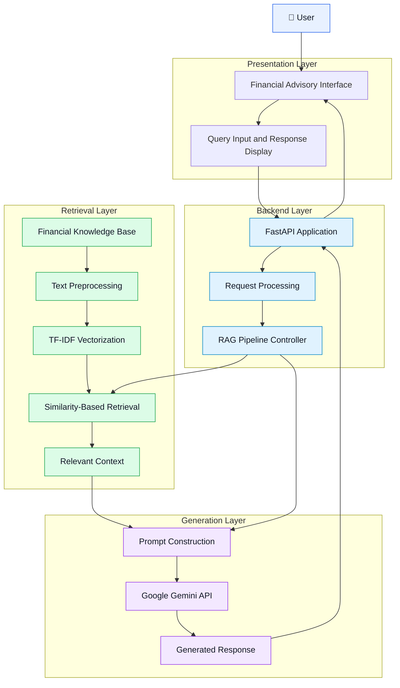
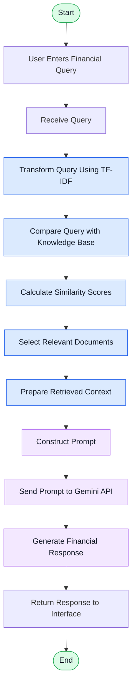
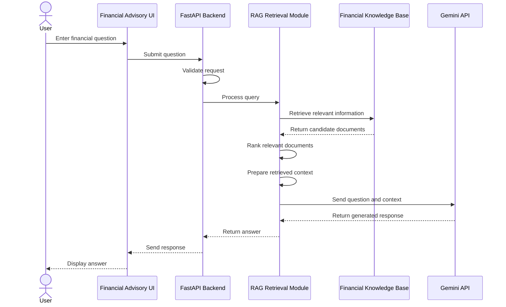

# 💰 Financial Advisor RAG
### AI-Powered Financial Advisory Using Retrieval-Augmented Generation

An AI-powered financial advisory system that combines Retrieval-Augmented Generation (RAG), TF-IDF-based information retrieval, and Google's Gemini API to deliver context-aware answers to financial queries.

The system retrieves relevant information from a financial knowledge base and uses a Large Language Model (LLM) to generate understandable responses grounded in the retrieved context.

The project demonstrates how information retrieval and generative AI can work together to build a domain-specific question-answering system.

---

## 📌 Table of Contents

- [Overview](#-overview)
- [Key Features](#-key-features)
- [System Architecture](#-system-architecture)
- [RAG Workflow](#-rag-workflow)
- [Sequence Diagram](#-sequence-diagram)
- [Technology Stack](#-technology-stack)
- [Project Structure](#-project-structure)
- [Installation and Setup](#-installation-and-setup)
- [How Retrieval Works](#-how-retrieval-works)
- [Example Use Cases](#-example-use-cases)
- [Security and Limitations](#-security-and-limitations)
- [Future Enhancements](#-future-enhancements)
- [Author](#-author)

---

## 🎯 Overview

Financial Advisor RAG is designed to answer financial questions by retrieving relevant information from a financial knowledge base before generating a response.

Unlike a basic chatbot that generates answers without consulting a project-specific knowledge source, a RAG-based system introduces a retrieval stage that supplies relevant external information to the language model.

The system combines three core components:

1. **Information Retrieval:** Finds relevant financial information using TF-IDF and similarity-based matching.
2. **Contextual Generation:** Uses Google's Gemini API to generate responses using the retrieved information and the user's query.
3. **Application Backend:** Uses Python and FastAPI to support backend request processing and integration.

The goal is to make financial information easier to understand while providing a foundation for more reliable, knowledge-grounded financial question answering.

## ✨ Key Features

- 🤖 **AI-Powered Financial Assistance:** Answers natural-language questions about financial concepts.
- 🔎 **RAG-Based Question Answering:** Retrieves relevant knowledge before generating a response.
- 📚 **TF-IDF Retrieval:** Uses lexical information retrieval to identify relevant text.
- 🧠 **Gemini API Integration:** Generates contextual, human-readable responses.
- ⚡ **FastAPI Backend:** Supports API-based backend processing.
- 🧩 **Modular Design:** Separates retrieval, generation, and application functionality.
- 💬 **Natural-Language Interaction:** Allows users to ask questions in everyday language.
- 🔐 **Environment-Based Configuration:** Supports secure management of API credentials.

---

# 🏗️ System Architecture

The architecture separates the user interface, backend request handling, retrieval pipeline, and LLM-based response generation.

### High-Level Architecture



### Architecture Components

| Layer | Component | Responsibility |
|---|---|---|
| Presentation | Financial Advisory Interface | Accepts questions and displays responses |
| Backend | FastAPI | Handles API requests and responses |
| Processing | Request Processing | Validates and prepares incoming requests |
| Orchestration | RAG Pipeline | Coordinates retrieval and generation |
| Knowledge | Financial Knowledge Base | Stores the information available for retrieval |
| Retrieval | TF-IDF | Converts textual documents into numerical representations |
| Retrieval | Similarity Matching | Identifies relevant information for a query |
| Generation | Prompt Construction | Combines the question with retrieved context |
| Generation | Gemini API | Generates the natural-language answer |

*Note: This is a logical architecture diagram. Adapt the component names and connections to your actual implementation before treating it as an exact representation of your code.*

---

# 🔄 RAG Workflow

The system follows a retrieval-then-generation workflow.

## Step-by-Step Process

**Step 1: User Query**

The user submits a financial question through the application interface.

Example:

> What is the difference between stocks and mutual funds?

**Step 2: Request Processing**

The application receives the question and passes it to the RAG pipeline.

**Step 3: Query Representation**

The retrieval component transforms the query into a numerical representation using the configured TF-IDF vectorizer.

**Step 4: Similarity-Based Retrieval**

The system compares the query representation with the representations of documents in the financial knowledge base.

**Step 5: Context Selection**

The most relevant matching text is selected and prepared as context.

**Step 6: Prompt Construction**

The question and retrieved information are assembled into a prompt for the language model.

**Step 7: LLM Generation**

The Gemini API generates a response based on the supplied prompt and its learned knowledge.

**Step 8: Response Delivery**

The generated response is returned to the application and displayed to the user.

### RAG Pipeline Flowchart



### Important Retrieval Detail

TF-IDF is a lexical retrieval technique. It measures the importance of terms in documents and can be combined with cosine similarity or another similarity measure to rank candidate documents.

It is not a semantic embedding model. Questions that use different terminology from the knowledge base may not retrieve the most relevant information.

---

# 🔁 Sequence Diagram

The following diagram illustrates the logical interaction between the user, interface, backend, retrieval component, and Gemini API during a typical question-answering request.



*This sequence describes the intended logical flow. The precise call order depends on the actual backend and retrieval implementation.*

---

# 🛠️ Technology Stack

| Technology | Purpose |
|---|---|
| Python | Core application and RAG logic |
| FastAPI | Backend API framework |
| Uvicorn | ASGI server for running FastAPI |
| Scikit-learn | TF-IDF vectorization and retrieval-related computations |
| Google Gemini API | Contextual response generation |
| Requests | HTTP communication with the Gemini API, if used by the implementation |
| Streamlit or another UI framework | User interface, depending on the integrated application |
| Git and GitHub | Version control and project hosting |
| Visual Studio Code | Development environment |

---

# 📂 Project Structure

The following is an illustrative structure based on the project files described. Update it to match your actual repository.

```text
Financial-advisory-Rag/
│
├── financial_advisory/
│   └── rag/
│       ├── generator.py
│       ├── retrieval.py
│       └── supporting_modules.py
│
├── ui_financial_advisory_tab.py
├── main.py
├── financial_advisory_requirements.txt
├── requirements.txt
├── .gitignore
├── .env.example
└── README.md
```

**Important:** The names `retrieval.py` and `supporting_modules.py` are illustrative placeholders, not verified filenames. Keep the actual filenames from your repository when updating this section.

### Component Responsibilities

- **`main.py`** — Application entry point, if configured as such.
- **`financial_advisory/`** — Financial advisory functionality.
- **`financial_advisory/rag/`** — Retrieval and generation components.
- **`ui_financial_advisory_tab.py`** — Financial advisory UI integration.
- **`financial_advisory_requirements.txt`** — Dependencies for the financial advisory feature, if used.
- **`requirements.txt`** — Main application dependencies, if present.
- **`.env.example`** — Example environment configuration without real credentials.
- **`.gitignore`** — Excludes secrets and unnecessary files from version control.

---

# ⚙️ Installation and Setup

## Prerequisites

Install the following:

- Python 3.10 or another version supported by your dependencies.
- pip
- Git
- Visual Studio Code, recommended.
- A Google Gemini API key.

## 1. Clone the Repository

```bash
git clone https://github.com/raghav-sharma-01/Financial-advisory-Rag.git
```

Navigate into the project directory:

```bash
cd Financial-advisory-Rag
```

## 2. Create a Virtual Environment

```bash
python -m venv venv
```

Activate the environment in Windows PowerShell:

```powershell
.\venv\Scripts\Activate.ps1
```

Alternatively, use Command Prompt:

```cmd
venv\Scripts\activate.bat
```

## 3. Install Dependencies

If your repository contains `requirements.txt`, run:

```bash
pip install -r requirements.txt
```

If the financial advisory feature has its own requirements file, also run:

```bash
pip install -r financial_advisory_requirements.txt
```

Use only the commands corresponding to files that actually exist in your project.

## 4. Configure the Gemini API Key

Create a local `.env` file in the directory from which your application reads environment variables.

Add:

```env
GEMINI_API_KEY=your_gemini_api_key
```

Obtain your key through Google AI Studio:

https://aistudio.google.com/

Replace the placeholder with your actual key.

Never commit the real `.env` file to GitHub.

## 5. Start the Backend

If `main.py` contains a FastAPI instance named `app`, run:

```bash
uvicorn main:app --reload
```

The local server should be available at:

```text
http://127.0.0.1:8000
```

If FastAPI is configured, interactive API documentation is generally available at:

```text
http://127.0.0.1:8000/docs
```

If your application uses another module or object name, adjust the command accordingly.

## 6. Launch the User Interface

Start the UI using the command required by your application.

For example, if the interface is a standalone Streamlit application:

```bash
streamlit run ui_financial_advisory_tab.py
```

This command is appropriate only if that file is a standalone Streamlit entry point. If it is a tab imported into another application, launch the main UI instead.

---

# 🔎 How Retrieval Works

The retrieval component identifies relevant text before the generation stage.

### TF-IDF Representation

TF-IDF stands for Term Frequency-Inverse Document Frequency.

It represents text numerically using term weights.

The general TF-IDF relationship is:

\[
TFIDF(t,d)=TF(t,d)\times IDF(t)
\]

Where:

- \(t\) represents a term.
- \(d\) represents a document.
- \(TF(t,d)\) measures the term's frequency within a document.
- \(IDF(t)\) reduces the weight of terms that occur frequently across the document collection.

### Similarity-Based Matching

After vectorization, the system can compare the query vector with document vectors using cosine similarity.

\[
\operatorname{Similarity}(q,d)=
\frac{q\cdot d}{\|q\|\|d\|}
\]

Where:

- \(q\) is the query vector.
- \(d\) is a document vector.
- The result measures the directional similarity between the vectors.

The retrieval component can rank candidate documents and select the most relevant information for the generation stage.

The exact vectorization, ranking, and selection behavior should be documented according to the implementation in your source code.

### Why RAG?

RAG offers several advantages over generation without external retrieval:

- Provides relevant external context to the language model.
- Allows answers to incorporate information from a project-specific knowledge base.
- Makes it possible to update reference information without retraining the language model.
- Separates information retrieval from natural-language generation.
- Provides a foundation for adding source citations and retrieval evaluation.

RAG does not automatically guarantee factual accuracy. Response quality depends on the retrieved content, prompt construction, and language model.

---

# 💡 Example Use Cases

The system can support financial education and information retrieval.

| Category | Example Question |
|---|---|
| Personal Finance | How can I create a monthly budget? |
| Investment Education | What is the difference between stocks and mutual funds? |
| Banking | What is compound interest? |
| Financial Planning | Why is an emergency fund important? |
| Economics | How does inflation affect purchasing power? |
| Financial Literacy | What is the difference between saving and investing? |

These examples illustrate potential queries. Actual answer quality and supported topics depend on the available knowledge base and application configuration.

---

# 🔐 Security and Limitations

### API Key Security

- Store credentials in environment variables.
- Exclude `.env` from Git version control.
- Never expose API keys in public repositories or screenshots.
- If a key is exposed, revoke it and generate a replacement.

### Financial Safety

- Generated responses may contain inaccurate or incomplete information.
- Users should independently verify important financial information.
- The application should not be treated as a substitute for a qualified financial advisor.
- Personalized investment recommendations require additional safeguards and appropriate financial context.

### Technical Limitations

- TF-IDF relies on lexical overlap and may miss semantically related information.
- Retrieval quality depends on the quality and coverage of the knowledge base.
- The Gemini API requires network connectivity and may impose usage limits.
- External API failures should be handled gracefully.
- Retrieved context does not guarantee that the generated response will be correct.

---

# 🚀 Future Enhancements

Potential future improvements include:

- **Semantic Retrieval:** Introduce embedding-based retrieval to improve matching when queries and documents use different wording.
- **Source Citations:** Display retrieved document references alongside generated answers.
- **Knowledge Base Expansion:** Add more verified financial documents and reference materials.
- **Evaluation Pipeline:** Measure retrieval relevance and answer quality using a consistent test dataset.
- **Improved Error Handling:** Add API timeouts, retries, and meaningful error messages.
- **Conversation History:** Support multi-turn financial conversations where appropriate.
- **Document Ingestion:** Build a pipeline for processing additional supported financial documents.
- **Security Improvements:** Introduce rate limiting, input validation, and appropriate authentication.
- **Deployment:** Deploy the backend and UI to suitable hosting platforms.

These are proposed enhancements, not claims about currently implemented functionality.

---

# 👨‍💻 Author

**Raghav Sharma**

- GitHub: [raghav-sharma-01](https://github.com/raghav-sharma-01)
- LinkedIn: [Raghav Sharma](https://www.linkedin.com/in/raghav-sharma--/)

---

# 📄 License

A license has not been specified yet.

If you intend to distribute this project publicly, consider adding an appropriate open-source license in a `LICENSE` file.

---

⭐ If you find this project useful, consider giving the repository a star.
